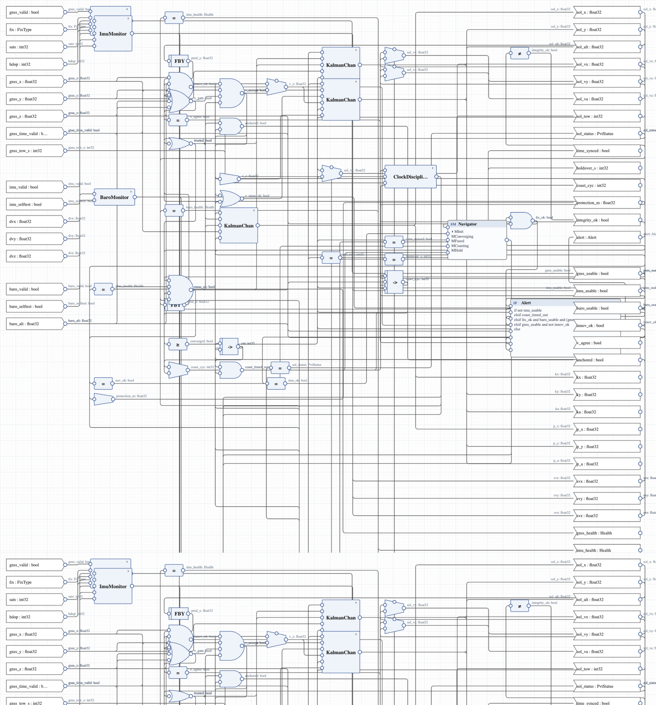

# PNT — a Position, Navigation and Time manager

A complete OpenLustre Studio project: the PNT core of a vehicle that fuses
GNSS, inertial and barometric sensor reports into one trusted
position/velocity/time solution. Three **float32 scalar Kalman channels**
(predict with the IMU, update with accepted fixes at gain k = P/(P+R))
carry the solution; a disciplined clock keeps time with bounded
holdover; and the integrity architecture — innovation gate, vertical
gate against the barometer, spike clamping at the source — makes sure no
sensor that disagrees with the fused truth can ever move it. It is the
navigation computer between the sensor plugins and the consumer,
inspired by [pntOS](https://www.pntos.com/), the open plugin
architecture for PNT sensor fusion (see the mapping table in
[PLAN.md](PLAN.md)). [PLAN.md](PLAN.md) is the specification:
requirements with ids, architecture, verification plan and results.

## Built with OpenLustre Studio

Modelled, tested, proved and turned into flight code with
[OpenLustre Studio](https://github.com/Shepherdhunt/OpenLustreStudio) —
the way a SCADE project is built with SCADE Suite. `OPENLUSTRE_VERSION`
pins the version it is built with; `scripts/env.sh` finds `openlustre`
($OPENLUSTRE, a project-local `.openlustre/bin`, PATH, or this machine's
toolchain build). Kind 2 v2.2.0 and Z3 4.13.4 live in
`~/.openlustre/tools` (`openlustre kind2 install` puts them there).

The float32 arithmetic is the generated C's arithmetic: single-precision
throughout (every real literal carries `_f32`), identical in the
simulator and the compiled code — the tests compare them byte for byte —
while the Kind 2 proofs reason about the exact reals behind the same
expressions.

```sh
scripts/verify.sh   # check, test, flight code, mission, proof, evidence
scripts/studio.sh   # open the PNT in the Studio (browser)
```

## The model

| operator | kind | what it does |
|----------|------|--------------|
| `PNT` | root node | wires it all; owns the **Navigator** state machine and the **Alert** decision tree |
| `GnssMonitor` | function | validity, fix type, satellites, HDOP → usable? + health |
| `ImuMonitor` | function | validity, self-test → usable? + health; increments **clamped** to ±2 m (20 m/s) on all three axes |
| `BaroMonitor` | function | the third plugin: barometer validity/self-test → usable? + health |
| `KalmanChan` | node | one axis of the scalar Kalman filter (predict / gate-checked update / bootstrap snap / Hold pause) |
| `ClockDiscipline` | node | a free-running second counter steered to GNSS TOW; holdover saturates at 10 s |
| `BoundedF` | function | float32 saturation (the spike firewall at the heart of the integrator) |

Types (`FixType`, `Health`, `PvtStatus`, `Alert`) and constants are in
`types.json`. Every operator carries a CoCoSpec contract whose clause
names are the requirement ids of the plan. Units: meters (float32),
meters per 100 ms cycle, TOW seconds; the base clock is **10 Hz**.



### The Navigator

```text
MInit ──fix+imu──► MConverging ──20 accepted fixes──► MFused ⇄ MCoasting
                        │  fix/imu lost                 │  IMU lost   │ budget spent
                        ▼                               ▼             ▼
                      MInit                            MHold ◄────────┘  (filter paused)
                                                        │ fix+imu
                                                        ▼
                                                  MConverging (bootstrap snap)
```

- **Fused** — the solution blends accepted fixes at gain k ≈ 0.11
  steady-state; protection level 10 m.
- **Coasting** — predict-only for at most `COAST_BUDGET_CYCLES` (5 s);
  the solution stays within `PROTECT_COAST_M` (120 m) of its last
  accepted value — proved. The vertical keeps measuring through the
  barometer.
- **Hold** — the filter pauses, outputs frozen, alerting; recovery snaps
  (variance reset to `P_CEIL`, first fix at k ≥ 0.5).

### The integrity safeguard (the pntOS idea, proved)

A fix is merged only if it **agrees** with the prediction (10 m, both
horizontal axes) — a valid-looking fix 300 m off is never merged, on any
cycle (`PVT_2`, Kind 2: valid). GNSS altitude is merged only within 15 m
of the barometer — a lying altitude leaves the horizontal solution
untouched and the vertical on the barometer (`ALT_1`, `INT-3`). An IMU
increment of 2000 m in one cycle is clamped to 2 m before it can touch
anything (`SRC_3`). After the coast budget the solution freezes rather
than drift (`PVT_3`, `PVT_4`), and the alert tree names the cause
(`AL_1..4`).

## Check, test, prove

```sh
openlustre check pnt.wksc
openlustre test run pnt.wksc --scenarios scenarios
#   30 passed (15 scenarios on the model and the compiled C); MC/DC 107/107
openlustre prove pnt.wksc --timeout 900
#   114 of 114 hold — contracts, mode coverage, realizability
#   runtime errors — 5 of 5 checks hold
openlustre evidence pnt.wksc --scenarios scenarios --prove --out out/evidence
#   evidence for `PNT`: PASS
```

| scenario | exercises |
|----------|-----------|
| `cold_start` | first fix: the filter snaps at gain ≈ 0.96, converges, fuses |
| `gnss_dropout` | a 3 s outage inside the budget: coast, then fusion again |
| `integrity_reject` | a valid fix 300 m off: rejected, coast, timeout, snap-back |
| `imu_fault` | self-test failure: hold with the filter paused; recovery |
| `clock_holdover` | 25 s outage: holdover bounded, tow free-runs, resync |
| `spike_reject` | a 2000 m increment: clamped to 2 m |
| `degraded_fix` | too few satellites / HDOP over: `SrcSuspect`, not usable |
| `acquisition_lost` | fix lost during convergence: back to Invalid |
| `time_loss` | fixes without time: not measurable, clock free-runs |
| `cross_axis` | y-only drift: the gate fails on one axis alone |
| `baro_fault` | self-test-only, valid-line-only, full baro loss; both plugins dark |
| `vertical_lie` | GNSS altitude lies up and down: the vertical rides the baro |
| `receiver_quirks` | the monitor's decision table, boundary by boundary |
| `combined_faults` | faults that only appear together, each timed to a specific guard |
| `week_rollover` | TOW saturates exactly at the end of the week |

## The flight code

```sh
openlustre emit-clite pnt.wksc --root PNT --out out/code
```

generates the PNT as C11 (`out/code/clite/openlustre_generated.{h,c}`):
one step function over explicit state — `PNT_init(&state)` once, then
`PNT_step(&state, &in, &out)` every 100 ms — with no allocation, no
globals and no library calls, every equation traced back to the diagram
(`trace.json`, `generation_report.md`). `integration/` puts it on a
vehicle:

| file | what |
|------|------|
| `pnt_platform.h` | what the flight computer provides: sample the plugins, publish the solution, `PNT_PERIOD_MS` |
| `pnt_task.c` | the 10 Hz cyclic task: read, step, write (`--realtime` paces it on the clock) |
| `pnt_clock.c` | the period clock for macOS, Linux and Windows (the RTOS timer replaces it on the vehicle) |
| `pnt_mission.c` | a desktop platform: a simulated vehicle, GNSS receiver, IMU and barometer flying a 62 s mission |
| `expected_mission.txt` | the mission's log, which `scripts/verify.sh` compares against |

```
t=  4.00 s #  40  status: fused (x=104.0, y=51.6, alt=50.4, tow=3604, prot=10)
t= 20.00 s # 200  alert: integrity          <- the receiver starts lying (300 m)
t= 20.10 s # 201  status: coasting (x=120.1, y=58.0, alt=52.0, tow=3620, prot=120)
t= 40.00 s # 400  alert: integrity          <- the receiver's ALTITUDE lies
t= 42.00 s # 420  alert: none               <- ...horizontal stayed fused throughout
t= 55.20 s # 552  status: hold (x=155.1, y=72.0, alt=55.5, tow=3654, prot=0)
t= 60.00 s # 600  status: fused (x=160.0, y=74.0, alt=56.0, tow=3660, prot=10)
```

On real hardware, replace `pnt_mission.c` with drivers for the GNSS
receiver, IMU and barometer (they fill the same `PNT_Input` the plugins
of pntOS would) and run `pnt_task.c`'s loop as the RTOS task that owns
the PNT.

## Files

| path | what |
|------|------|
| `pnt.wksc`, `types.json` | the workspace (operators, contracts, state machine, activation, layout; types and constants) |
| `*.lus` | each operator's Lustre, as Build writes it (the prover's view) |
| `scenarios/` | input vectors and recorded golden traces |
| `PLAN.md` | the implementation plan (requirements, verification, results) |
| `integration/` | the platform around the generated code, and the scripted mission |
| `OPENLUSTRE_VERSION` | the OpenLustre Studio commit the project is built with |
| `scripts/` | verify everything, open the Studio |
| `build/` | how the model was built in the Studio (`build_pnt.py` replays it through the editing API from `pnt_source.lus`) and how the scenarios were written (`make_scenarios.py`) |
| `out/` | generated: flight code, evidence, the mission log (not committed) |
